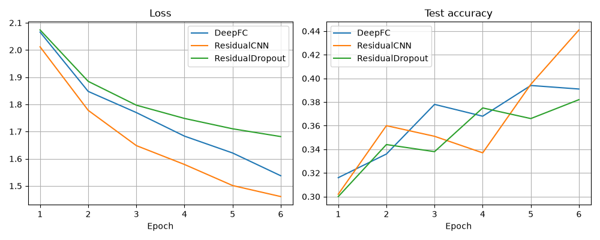
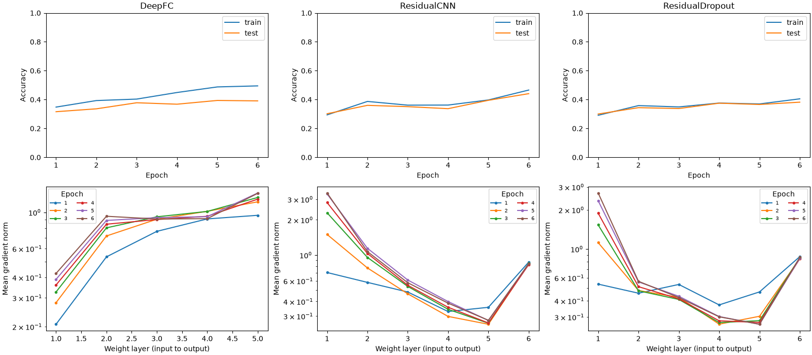
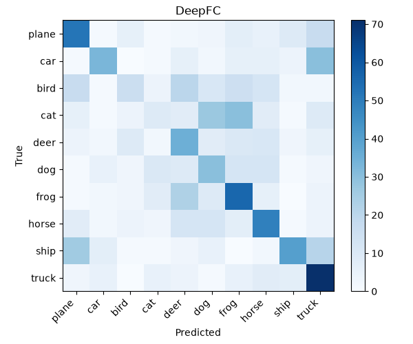
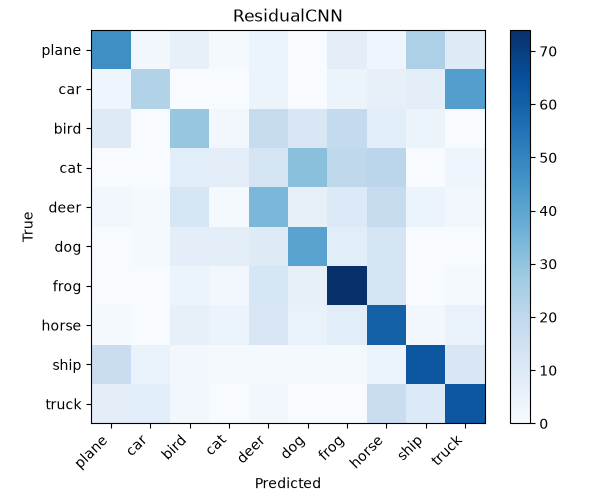
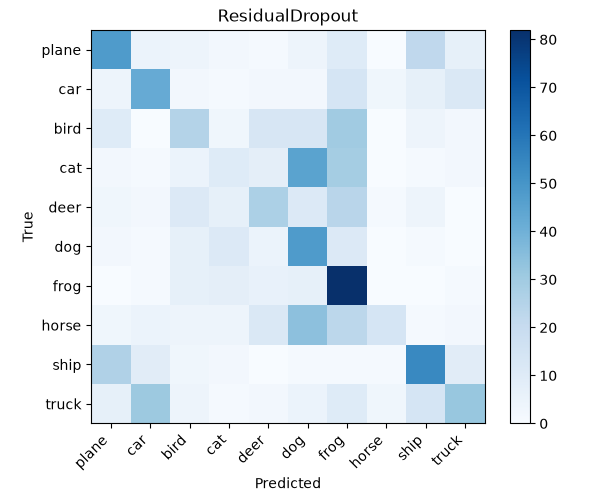

# Задание 1.2. Сравнение моделей на CIFAR-10

Первые 5 000 изображений обучающей и первые 1 000 изображений отдельной тестовой выборки CIFAR-10. Все модели прошли 6 эпох с пачками по 64, одинаковым порядком примеров, Adam, lr=0.001 и weight_decay=0.0001. В двух ResidualCNN одинаковые начальные веса и два residual-блока. В третьем варианте внутри блоков включён Dropout2d с вероятностью 0.2. В глубокой FCNet четыре скрытых слоя (512, 256, 128 и 64 нейрона).

| Модель | Точность на обучении | Точность на тесте | Верно из 1000 | Время обучения на CPU | Параметры |
|---|---:|---:|---:|---:|---:|
| Глубокая FCNet | 49,48% | 39,1% | 391 | 11,71 с | 1 746 506 |
| ResidualCNN | 46,60% | 44,1% | 441 | 76,76 с | 38 538 |
| ResidualCNN с Dropout | 40,52% | 38,2% | 382 | 52,42 с | 38 538 |

Точность на обеих выборках измерялась в режиме оценки после каждой эпохи. Время обучения исключает проверку точности, но включает расчёт норм градиентов. Время зависит от нагрузки на компьютер. В таблице приведена последняя эпоха одного запуска.

## Точность и переобучение

У обычной ResidualCNN на 50 верных ответов больше, чем у FCNet. У FCNet самый большой разрыв между обучением и тестом — 10,38 процентного пункта. С третьей по шестую эпоху точность FCNet на обучении поднялась с 40,34% до 49,48%, на тесте — с 37,8% до 39,1%. Это признак переобучения. У ResidualCNN итоговый разрыв 2,50 пункта, с Dropout — 2,32 пункта. При включении Dropout тестовая точность в этом запуске снизилась на 5,9 пункта.

## Градиенты

Для весов каждого линейного и свёрточного слоя после backward измерялась L2-норма градиента, затем значения усреднялись по пачкам за эпоху. На шестой эпохе нормы первого и последнего слоя равны 0,423 и 1,306 у FCNet, 3,395 и 0,843 у ResidualCNN, 2,695 и 0,862 у версии с Dropout. Градиент доходил до первого слоя всех трёх моделей. По одной норме судить о качестве модели нельзя: она зависит в том числе от размера слоя.

## Какие классы путали модели

В матрицах строки — правильные классы, столбцы — ответы сети. Самая частая ошибка FCNet и ResidualCNN — легковая машина, распознанная как грузовик (30 и 42 случая). У модели с Dropout самая частая ошибка — кошка, распознанная как собака (45 случаев).

